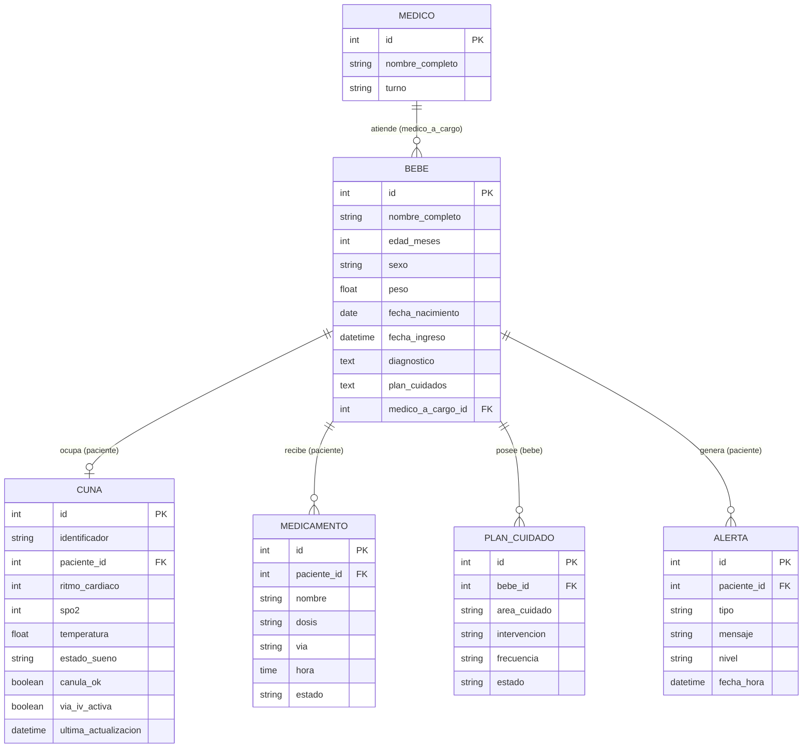

# Poki Koa — Sistema de Monitoreo Neonatal (Backend)

> **Poki** (niño/hijo) · **Koa** (alegría, estar contento) — Lengua Rapa Nui

Sistema de monitoreo inteligente de cunas neonatales diseñado para supervisar en tiempo real las constantes vitales y parámetros ambientales de recién nacidos en unidades de cuidado. Centraliza alertas tempranas y datos clínicos para el personal médico.

El nombre **Poki Koa** entrega identidad nacional al proyecto mediante palabras de la lengua Rapa Nui, complementado con la figura del **Moai** como elemento visual que refuerza los conceptos de protección, cuidado y vigilancia permanente.

---

## Documentación del Proyecto

| Grupo | Documentos |
|---|---|
| Proyecto | [Arquitectura](./docs/proyecto/Arquitectura.md) · [Requisitos extrafuncionales](./docs/proyecto/ReqExtrafuncionales.md) |
| Entrega 2 — APIs | [Documentación de APIs](./docs/entrega2/DOCUMENTACION_APIS.md) |
| Entrega 2 — Pruebas | [Matriz de casos](./docs/entrega2/MATRIZ_CASOS.md) · [Resultados](./docs/entrega2/REGISTRO_EJECUCION.md) · [Instalación y uso de Bruno](./docs/entrega2/USO_BRUNO.md) |
| Entrega 2 — Refinamiento | [Conversación con Clarita](./docs/entrega2/evidencias/clarita/clarita_reviews_chat.md) |
| Actividades de clase | [Diagnóstico](./docs/actividades/Actividad-Diagnostico.md) · [Ejercicio 2.2: construcción para la verificación](./docs/actividades/ejercicio-2-2.md) |

El Entregable 2 incluye las APIs de pacientes y catálogo de medicamentos con
stock (`/api/catalogo-medicamentos/`). El catálogo es independiente de las
asignaciones de medicación por paciente. El equipo ejecutó los 44 casos (22 por API)
en Bruno 4.2.1: 94 solicitudes y 265 verificaciones aprobadas, sin fallos ni omisiones.
Los resultados están en el [registro de ejecución](./docs/entrega2/REGISTRO_EJECUCION.md)
y en el [reporte del equipo](./qa/entrega2/resultado-bruno-equipo.html).
La [colección Bruno](./qa/entrega2/bruno/) contiene las solicitudes y sus verificaciones.
El motivo del cambio de herramienta se explica en [Uso de Bruno](./docs/entrega2/USO_BRUNO.md).

## Arquitectura

El sistema implementa una arquitectura desacoplada cliente-servidor:

```text
Backend (este repositorio)       Frontend (repositorio aparte)
┌─────────────────────────┐      ┌────────────────────────┐
│  Django REST Framework  │◄────►│  React + Vite          │
│  SQLite (desarrollo)    │      │  Puerto: 5173          │
│  Puerto: 8000           │      └────────────────────────┘
└─────────────────────────┘
```

- **API REST**: `http://127.0.0.1:8000/api/` (endpoints para `/api/medicos/`, `/api/bebes/`, `/api/cunas/`, etc.)
- **Panel Administrativo**: `http://127.0.0.1:8000/admin/`

---

## Guía de Instalación y Puesta en Marcha

Sigue estos pasos para clonar, configurar y ejecutar el backend localmente en pocos minutos.

### Requisitos Previos

- [Git](https://git-scm.com/)
- [Python](https://www.python.org/) 3.10 o superior
- [`uv`](https://docs.astral.sh/uv/) (gestor de entornos y dependencias de alto rendimiento)

> **Instalación rápida de `uv` (si aún no lo tienes):**
> - **Linux o macOS:**
>   ```bash
>   curl -LsSf https://astral.sh/uv/install.sh | sh
>   ```
> - **Windows (PowerShell):**
>   ```powershell
>   powershell -ExecutionPolicy ByPass -c "irm https://astral.sh/uv/install.ps1 | iex"
>   ```

---

### Paso a Paso

#### 1. Clonar el repositorio
```bash
git clone https://github.com/Asulx/poki-koa-backend.git
cd poki-koa-backend
```

#### 2. Sincronizar dependencias
Crea automáticamente el entorno virtual en `.venv/` e instala todas las dependencias requeridas:
```bash
uv sync
```

#### 3. Aplicar migraciones
Inicializa o actualiza la base de datos SQLite con los modelos del sistema:
```bash
uv run poki_koa migrate
```

Este comando usa `src/db.sqlite3`. La base está excluida para nuevos cambios por
`.gitignore`, aunque ya existe una copia histórica versionada en este repositorio.
No uses datos reales de pacientes en entornos locales ni en archivos de SQLite
versionados.

#### 4. Iniciar el servidor de desarrollo
```bash
uv run poki_koa
```

El backend quedará accesible en:
- **API REST**: [http://127.0.0.1:8000/api/](http://127.0.0.1:8000/api/)
- **Panel de Administración**: [http://127.0.0.1:8000/admin/](http://127.0.0.1:8000/admin/)

> *Nota alternativa:* También es posible utilizar directamente la CLI estándar de Django mediante `python src/manage.py [comando]`.

---

## Comandos Útiles

| Comando | Descripción |
|---|---|
| `uv run poki_koa` | Inicia el servidor de desarrollo en el puerto 8000 |
| `uv run poki_koa migrate` | Aplica migraciones pendientes a la base de datos |
| `uv run poki_koa makemigrations` | Genera nuevas migraciones tras modificar modelos |
| `uv run poki_koa test` | Ejecuta la suite de pruebas unitarias |
| `uv run poki_koa test cunas` | Ejecuta las pruebas de la app principal |
| `uv run poki_koa makemigrations --check` | Comprueba que los modelos no requieran migraciones nuevas |
| `uv run poki_koa createsuperuser` | Crea un usuario administrador para el panel `/admin/` |
| `uv run poki_koa simular_alertas` | Simula signos vitales y evalúa alertas en consola |
| `uv run make-crud <Modelo>` | Genera automáticamente Model, Serializer, ViewSet y URL para una entidad |
| `uv run ruff check src` | Analiza el código con [Ruff](https://docs.astral.sh/ruff/) para detectar errores y estilo |

La suite Django contiene actualmente 44 tests. La matriz de 44 casos Bruno del
Entregable 2 es una prueba aparte de los endpoints de pacientes y catálogo; su
procedimiento y resultados están descritos en la [guía de Bruno](./docs/entrega2/USO_BRUNO.md).

### Entorno de demostración del Entregable 2

La configuración `poki_koa.settings_entregable` selecciona
`src/db_entregable.sqlite3` en lugar de la base normal. Para preparar los datos
ficticios del entregable:

```bash
uv run poki_koa migrate --settings=poki_koa.settings_entregable
uv run poki_koa preparar_entregable --settings=poki_koa.settings_entregable
```

El comando se niega a operar si no se seleccionó explícitamente esa configuración.
Para volver a cargar los datos demo, agrega `--reset`. El reset vacía únicamente la
base de demostración:

```bash
uv run poki_koa preparar_entregable --settings=poki_koa.settings_entregable --reset
```

Las bases SQLite de desarrollo y demostración están ignoradas para archivos nuevos,
pero ambas están presentes en el historial actual. Verifica su contenido antes de
compartir una copia del repositorio.

### Configuración y seguridad

`src/poki_koa/settings.py` es configuración local de desarrollo, no una configuración
lista para desplegar: contiene una clave secreta de desarrollo, `DEBUG=True`,
`ALLOWED_HOSTS=["*"]` y una lista CORS de localhost. La API tampoco define actualmente
autenticación ni permisos por endpoint. Antes de exponer el servicio, deben definirse
valores por entorno, hosts/orígenes autorizados, autenticación y permisos adecuados
al acceso a datos clínicos. No se deben registrar lecturas ni datos identificables de
pacientes; los logs de telemetría registran solo el identificador de cuna.

El endpoint `POST /api/cunas/{id}/telemetria/` valida explícitamente el ritmo
cardíaco, mientras los otros campos recibidos aún no tienen validaciones equivalentes
en esa vista. Definir rangos y respuestas esperadas con responsables clínicos antes
de restringirlos, porque los valores aceptados forman parte del comportamiento actual.

### Automatización de Recursos (`make-crud`)

Para acelerar la creación de nuevas entidades y evitar configuraciones repetitivas:
```bash
uv run make-crud <NombreModelo>
```

**Ejemplo:**
```bash
uv run make-crud Diagnostico
```

Este comando genera y conecta de forma automática:
1. **`models.py`**: Estructura base del modelo (respeta tu código si ya existía).
2. **`serializers.py`**: `ModelSerializer` correspondiente.
3. **`views.py`**: `ModelViewSet` con operaciones CRUD completas.
4. **`urls.py`**: Registro automático en el router REST (ej: `/api/diagnosticos/`).

> **Importante:** Tras crear o editar cualquier modelo, recuerda generar y aplicar la migración:
> ```bash
> uv run poki_koa makemigrations
> uv run poki_koa migrate
> ```

---

## Estructura del Proyecto

```text
.
├── pyproject.toml          # Dependencias y comandos de ejecución (uv + hatchling)
├── uv.lock                 # Registro exacto de versiones de dependencias
├── .python-version         # Versión de Python fijada para el proyecto
├── docs/
│   ├── proyecto/           # Arquitectura y requisitos extrafuncionales
│   ├── actividades/        # Diagnóstico y ejercicios de clase
│   └── entrega2/           # APIs, matriz, resultados y uso de Bruno
│       └── evidencias/clarita/ # Conversación de revisión de historias
├── qa/entrega2/            # Casos, colecciones y evidencia de pruebas API
└── src/
    ├── manage.py           # CLI estándar de Django (uso alternativo sin uv)
    ├── poki_koa/           # Configuración central del proyecto Django
    │   ├── settings.py     # Ajustes globales (base de datos, apps, CORS)
    │   ├── settings_entregable.py # Settings aislados para la demo del Entregable 2
    │   ├── urls.py         # Rutas principales: /admin/ y /api/
    │   ├── asgi.py         # Entrada ASGI
    │   ├── wsgi.py         # Entrada para servidores WSGI
    │   └── main.py         # Entrada del comando `poki_koa`
    └── cunas/              # Aplicación principal del dominio neonatal
        ├── models.py       # Modelos clínicos (Medico, Bebe, Cuna, Medicamento, etc.)
        ├── serializers.py  # Serializadores JSON para la API REST
        ├── views.py        # ViewSets con endpoints CRUD
        ├── urls.py         # Router REST bajo /api/
        ├── alertas.py      # Evaluación, deduplicación y resolución de alertas
        ├── signals.py      # Ejecuta el motor de alertas al guardar una cuna
        ├── services.py     # Servicio de dominio para telemetría de cunas
        ├── admin.py        # Registro en el panel administrativo
        ├── tests.py        # Pruebas de modelos, API y motor de alertas
        ├── test_catalogo.py # Contrato API y persistencia del catálogo
        ├── test_migrations.py # Prueba de migración de identificadores
        ├── management/     # make-crud, simulador y preparación de demo
        └── migrations/     # Historial de migraciones generadas
```

Las rutas actuales incluyen `/api/medicos/`, `/api/bebes/`, `/api/cunas/`,
`/api/medicamentos/`, `/api/catalogo-medicamentos/`, `/api/planes-cuidado/` y
`/api/alertas/`. La cuna también expone la acción de telemetría. Los nombres de
campos y formatos serializados son consumidos por el frontend y deben tratarse como
contrato de compatibilidad.

---

## Pendientes conocidos

Estos asuntos requieren definición o trabajo antes de considerar el backend listo
para un entorno clínico expuesto:

1. **Seguridad de despliegue:** cargar `SECRET_KEY`, `DEBUG`, `ALLOWED_HOSTS` y CORS
   desde configuración de entorno, y definir autenticación/permisos para cada rol.
2. **Datos sensibles:** determinar si las bases SQLite versionadas contienen datos
   reales o credenciales; si corresponde, retirar los archivos del control de versiones
   y evaluar la exposición histórica.
3. **Validación de telemetría:** acordar y probar rangos para SpO₂, temperatura,
   estado de sueño y dispositivos con responsables clínicos, manteniendo documentado
   cualquier cambio de contrato.
4. **Automatización:** añadir CI que ejecute `uv sync`, `uv run poki_koa test`,
   `uv run poki_koa makemigrations --check` y `uv run ruff check src` en cada PR.
5. **Generador CRUD:** agregar pruebas a `make-crud` y reemplazar o limitar la edición
   de Python por expresiones regulares antes de depender de él en cambios rutinarios.
6. **Datos del equipo:** mantener roles y aportes ligados a la evidencia del entregable;
   la tabla de roles histórica al final corresponde a otras actividades.

---

## Entidades del Dominio



---

## Historias de Usuario

Todas las historias de usuario están registradas como GitHub Issues:

| ID | Nombre | Issue |
|---|---|---|
| US-01 | Formulario de gestion de pacientes | [#1](https://github.com/Asulx/poki-koa-web/issues/15) |
| US-02 | Formulario de gestion de medicamentos | [#2](https://github.com/Asulx/poki-koa-web/issues/17) |
| US-03 | Listado de medicamentos | [#3](https://github.com/Asulx/poki-koa-web/issues/16) |
| US-04 | Listado de pacientes | [#4](https://github.com/Asulx/poki-koa-web/issues/13) |
| US-05 | Busqueda de filtros y pacientes | [#5](https://github.com/Asulx/poki-koa-web/issues/14) |
| US-06 | Graficos interactivos y visualizacion de estadisticas | [#6](https://github.com/Asulx/poki-koa-web/issues/12) |
| US-07 | Vista y logica del modulo de reportes | [#7](https://github.com/Asulx/poki-koa-web/issues/18) |
| US-08 | Exportacion de reportes (PDF y Excel) | [#8](https://github.com/Asulx/poki-koa-web/issues/19) |
| US-09 | Gestion y modificacion de turnos por ADMIN | [#9](https://github.com/Asulx/poki-koa-web/issues/39) |
| US-10 | Navegacion interactiva de Monitor de cuna hacia detalles de bebe | [#10](https://github.com/Asulx/poki-koa-web/issues/40) |

---

## Roles de Equipo — asignación histórica

Esta tabla documenta roles de una entrega anterior y no declara responsabilidades del Entregable 2.

| Integrante | Rol | Ítems de la rúbrica a cargo |
| :--- | :--- | :--- |
| **Sebastian Quinzacaras** | Analista / Arquitecto | • 1.1 Historias de Usuario: Completitud<br>• 1.1 Historias de Usuario: Correctitud (forma)<br>• 1.1 Historias de Usuario: Calidad |
| **Ricardo Figueroa** | Diseñador de Software | • 2.3 Diseño Arquitectónico: Módulos - Completitud<br>• 2.1 Diseño Arquitectónico: Módulos - Calidad |
| **Mauricio Escobar** | Líder Técnico | • 2.2 Diagrama de Arquitectura: Consistencia<br>• 2.4 Entidades del dominio: Completitud |
| **Ricardo Loyola** | Arquitecto de Software | • 1.2 Requisitos Extrafuncionales: Catálogo extrafuncionales<br>• 2.1 Diseño Arquitectónico: Estilo arquitectónico |
| **Fabian Mamani** | QA Tester / Diseñador UI | • 2.3 Mockups: Consistencia |
| **Sarai Herrera** | Analista / Arquitecto | • 1.1 Historias de Usuario: Completitud<br>• 1.1 Historias de Usuario: Correctitud (forma)<br>• 1.1 Historias de Usuario: Calidad |
